<a href="https://www.anshrajput.com"></a>

  
  
  
  

I'm a Computer Engineering co-op student at the University of Alberta and a full-stack developer. I take an idea from first sketch to a live product on my own: schema, API, interface, deployment, and the email that lands after someone presses send. Two businesses already run on platforms I built, and I'm building a third as a founder.

After hours I build games. I taught myself Unreal Engine C++ by making five of them, then rebuilt all five so they play in the browser.

**Open to** software engineering co-op and internship roles from May 2027, including relocation.

<a href="https://www.anshrajput.com">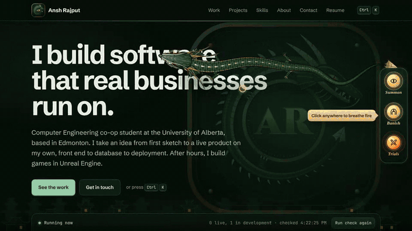</a>

Recorded live on <a href="https://www.anshrajput.com">anshrajput.com</a>. Nothing here is a mockup.

## Products and client work

<table>
<tr>
<td width="50%" valign="top">
<a href="https://www.anshrajput.com/#ucert">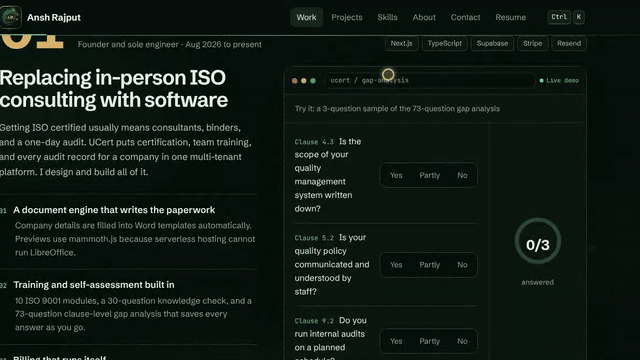</a>
<h3><a href="https://www.anshrajput.com/#ucert">UCert</a></h3>
A multi-tenant ISO certification platform I founded. It generates each standard's preloaded Word documents and keeps every certification record in one place, with a 73-question gap analysis and Stripe billing across 3 plans. In development.
  
<b>Next.js · TypeScript · Supabase · Stripe</b>
 
<a href="https://www.anshrajput.com/#ucert">Try the gap analysis sample</a>
</td>
<td width="50%" valign="top">
<a href="https://www.anshrajput.com/#certcanada">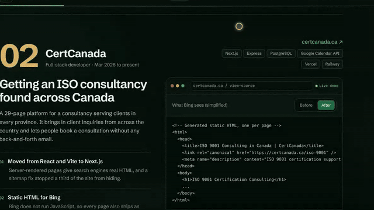</a>
<h3><a href="https://certcanada.ca">CertCanada</a></h3>
The 29-page platform an ISO consultancy runs on. Moving it from React and Vite to Next.js server rendering grew its search-indexed pages from 19 to 29, and self-serve booking on the Google Calendar API replaced scheduling emails.
  
<b>Next.js · Express · PostgreSQL · Google Calendar API · JWT</b>
 
<a href="https://certcanada.ca">Live site</a> · <a href="https://www.anshrajput.com/#certcanada">Case study</a>
</td>
</tr>
<tr>
<td width="50%" valign="top">
<a href="https://www.anshrajput.com/#twish">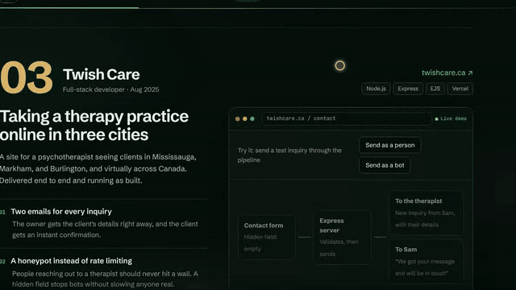</a>
<h3><a href="https://twishcare.ca">Twish Care</a></h3>
A psychotherapy practice's site, live in 3 Ontario cities. Every inquiry reaches the owner instantly with a confirmation to the client, and a honeypot quietly drops bots.
  
<b>Node.js · Express · Google Business Profile</b>
 
<a href="https://twishcare.ca">Live site</a> · <a href="https://github.com/rajputansh09/project_TWISH">Code</a> · <a href="https://www.anshrajput.com/#twish">Case study</a>
</td>
<td width="50%" valign="top">
<a href="https://www.anshrajput.com">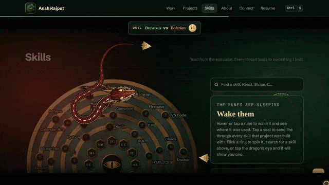</a>
<h3><a href="https://www.anshrajput.com">anshrajput.com</a></h3>
My portfolio, built from scratch. Two dragons with their own steering, fire and a scripted duel run on a Canvas 2D engine I wrote, and bots that play every game level double as Playwright regression tests.
  
<b>Next.js 16 · React 19 · TypeScript · Canvas 2D · Vercel</b>
 
<a href="https://www.anshrajput.com">Live site</a> · <a href="https://github.com/rajputansh09/anshrajput.com">Code</a>
</td>
</tr>
</table>

## Play them in the browser

Every clip below is a bot playing the real game on my site. Open one and take over.

<table>
<tr>
<td width="50%" valign="top">
<a href="https://www.anshrajput.com">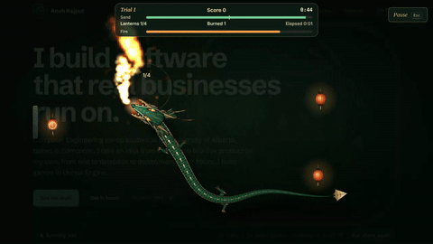</a>
 <b><a href="https://www.anshrajput.com">The Dragon's Trial</a></b>
 Fly the green dragon and burn every lantern before the sand runs out. Each trial gives you less sand.
</td>
<td width="50%" valign="top">
<a href="https://www.anshrajput.com">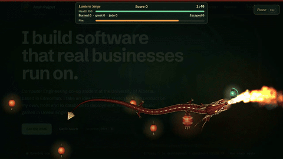</a>
 <b><a href="https://www.anshrajput.com">The Lantern Siege</a></b>
 Lanterns rise from the streets below. Burn them with the red dragon before they escape.
</td>
</tr>
<tr>
<td width="50%" valign="top">
<a href="https://www.anshrajput.com/#games">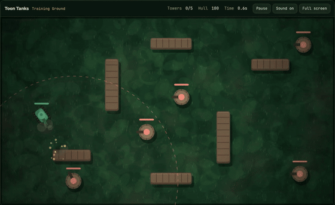</a>
 <b><a href="https://github.com/rajputansh09/Toon_Tanks">Toon Tanks</a></b>
 Destroy every tower before it wears your tank down. Same numbers as my Unreal C++ original.
</td>
<td width="50%" valign="top">
<a href="https://www.anshrajput.com/#games">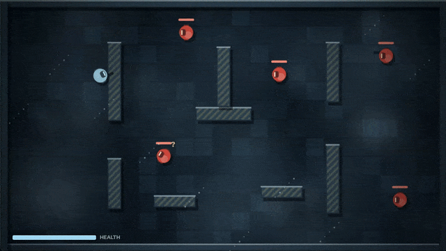</a>
 <b><a href="https://github.com/rajputansh09/Simple_Shooter">Simple Shooter</a></b>
 Clear the lab of robots that chase you while they see you and search when they lose you.
</td>
</tr>
<tr>
<td width="50%" valign="top">
<a href="https://www.anshrajput.com/#games">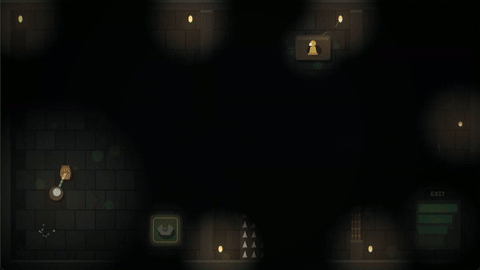</a>
 <b><a href="https://github.com/rajputansh09/Crypt_Raider">Crypt Raider</a></b>
 Carry relics onto pressure plates to open the gates, and time your way past the spikes.
</td>
<td width="50%" valign="top">
<a href="https://www.anshrajput.com/#games">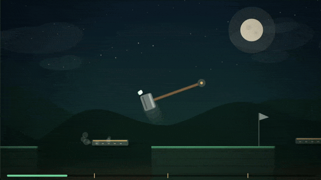</a>
 <b><a href="https://www.anshrajput.com/#games">Obstacle Assault</a></b>
 Moving platforms, swinging hammers and floors that give way, against the clock.
</td>
</tr>
<tr>
<td width="50%" valign="top">
<a href="https://www.anshrajput.com/#games">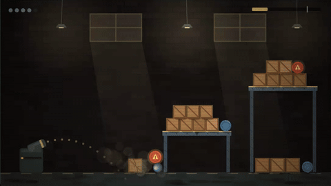</a>
 <b><a href="https://www.anshrajput.com/#games">Warehouse Wreckage</a></b>
 Five shots to break the warehouse. Crates stack, slide and topple, and red barrels explode.
</td>
<td width="50%" valign="top">
<a href="https://www.anshrajput.com/#skills">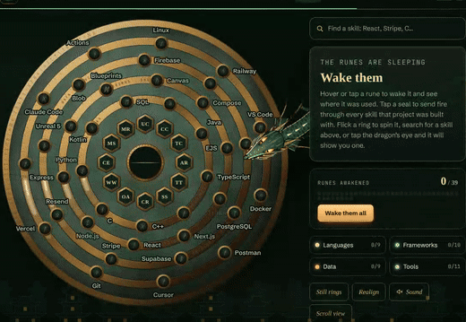</a>
 <b><a href="https://www.anshrajput.com/#skills">Skills astrolabe</a></b>
 My skills as a working instrument. Wake the runes and fire runs to every project that used them.
</td>
</tr>
</table>

<b>More projects</b>

 

| Project | What it is | Built with |
|---|---|---|
| [Carbon Events](https://github.com/CMPUT301F26carbon/carbon-events) | Android app for lottery-based campsite booking. I built the explore, search and details screens in a 6-person team. | Kotlin, Jetpack Compose, Firebase |
| Mistune testing | Compared black-box, white-box and AI-written test suites on Mistune, a Markdown parser with 20M+ monthly downloads. I led the AI-driven black-box testing. | Python, LLM testing |
| MapReduce | Thread-safe thread pool and MapReduce library in C, built on mutexes and condition variables and checked with Valgrind. | C, pthreads, Valgrind |

<b>Tech I work with</b>

 

| | |
|---|---|
| **Languages** | TypeScript, JavaScript, C, C++, Python, Java, Kotlin, SQL |
| **Web** | Next.js, React, Node.js, Express, Tailwind CSS |
| **Data and services** | PostgreSQL, Supabase, Firebase, Stripe, Resend, Google Calendar API |
| **Games** | Unreal Engine 5, C++, Canvas 2D, Web Audio |
| **Tools** | Git, GitHub Actions, Docker, Linux, Playwright, Vercel |

Want to talk? <a href="https://www.anshrajput.com/#contact">Send me a message</a>. I reply to every one.

